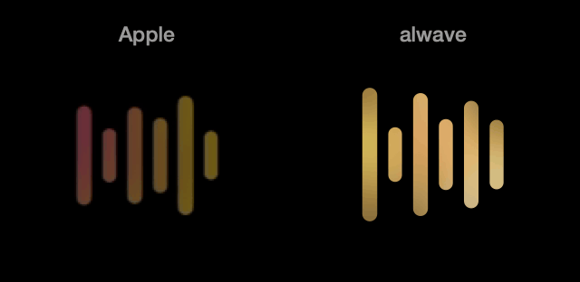

# apple-like-waves

[中文](README.md) · [English](README.en.md)

An audio spectrum visualizer inspired by Apple's system animations, available for Swift and the web.



[Live Demo](https://kmgcc.github.io/apple-like-waves/)

apple-like-waves (alwave) converts real-time audio into animated capsule bars with smooth spring physics. It is designed for music players, voice recorders, and interactive audio interfaces.

## Features

- Capsule bar motion inspired by Apple's system audio spectrum
- Supports 6 to 36 frequency bands, with `recommendedBandCount` for width-based layout
- Responsive to beats and volume changes
- Smooth spring animation and collapse transition on pause
- Customizable colors, bar width, spacing, and sensitivity
- Supports SwiftUI (`CapsuleSpectrumView`), AppKit (`CapsuleSpectrumHostView` backed by `CALayer`), and HTML Canvas (`AlwaveCanvasRenderer`)

## Live Demo

A web demo featuring a built-in track, local audio file upload, microphone input, and live parameter controls is available online:

[Try the demo](https://kmgcc.github.io/apple-like-waves/)

## Getting Started

### Swift

Requires iOS 16+ or macOS 14+. Add apple-like-waves to your `Package.swift`:

```swift
dependencies: [
    .package(url: "https://github.com/kmgcc/apple-like-waves.git", from: "1.0.0")
]
```

Add the `Alwave` library product to your target:

```swift
.target(
    name: "YourApp",
    dependencies: [
        .product(name: "Alwave", package: "apple-like-waves")
    ]
)
```

Process audio and drive the visualizer:

```swift
import SpectrumCore
import SpectrumUI

// Initialize the analyzer
let analyzer = SpectrumAnalyzer(bandCount: 6, sampleRate: 48000)

// In your audio tap or callback:
analyzer.pushSamples(pcm: pcmBuffer)

// On frame updates (e.g. CADisplayLink), step forward to get normalized [0, 1] heights:
let targets = analyzer.step(dt: 1.0 / 60.0)
```

Render with SwiftUI:

```swift
CapsuleSpectrumView(values: targets)
```

Render with AppKit (`NSView`):

```swift
let hostView = CapsuleSpectrumHostView(capsuleCount: 6)
hostView.update(values: targets)
hostView.isPaused = false
```

Calculate recommended band count from view width:

```swift
let bandCount = SpectrumAnalyzer.recommendedBandCount(width: view.bounds.width)
```

### Web

The web packages (`@alwave/core` and `@alwave/canvas`) are located in the `web/` workspace of this repository. Clone and build the packages locally:

```bash
git clone https://github.com/kmgcc/apple-like-waves.git
cd apple-like-waves/web
pnpm install
pnpm build
```

Then import from the packages in your project:

```typescript
import { createSpectrumAnalyzer, recommendedBandCount } from "@alwave/core";
import { AlwaveCanvasRenderer } from "@alwave/canvas";

// Create analyzer instance
const analyzer = createSpectrumAnalyzer({
  bandCount: 6,
  sampleRate: 48000
});

// Attach Canvas renderer
const canvas = document.getElementById("visualizer") as HTMLCanvasElement;
const renderer = new AlwaveCanvasRenderer(canvas, { bandCount: 6 });
// Optional: use cover art as blurred capsule fill
// renderer.setArtwork(coverImage);

const pcmBuffer = new Float32Array(2048);

function render() {
  const dt = 1 / 60;
  analyserNode.getFloatTimeDomainData(pcmBuffer);
  analyzer.pushSamples(pcmBuffer);

  const targets = analyzer.step(dt);
  renderer.render(targets, dt);

  requestAnimationFrame(render);
}
requestAnimationFrame(render);
```

## Customization

| Parameter | Type | Default | Description |
|---|---|---|---|
| `bandCount` | `Int` / `number` | `6` | Number of frequency bands (6–36) |
| `sampleRate` | `Double` / `number` | `48000` | Input PCM sample rate in Hz |
| `inputGain` | `Double` / `number` | `1.0` | Pre-analysis input gain multiplier |
| `reactivity` | `Double` / `number` | `1.0` | Attack boost multiplier for transients |
| `noiseGateScale` | `Double` / `number` | `1.0` | Noise gate threshold scaling |
| `capsuleWidth` | `CGFloat` / `number` | `4.0` | Default capsule width in points or pixels |
| `capsuleSpacing` | `CGFloat` / `number` | `3.0` | Spacing between adjacent capsules |
| `barColor` / `color` | `Color` / `string` | `.white` / `"#E6C450"` | Fill color of the capsules |
| `artwork` | `CanvasImageSource | null` | `null` | Blurred album artwork clipping mask (Web Canvas) |
| `springDuration` | `Double` / `number` | `0.325` | Characteristic settling duration in seconds |
| `springDamping` | `Double` / `number` | `0.83` | Damping ratio $\zeta$ (~0.9% overshoot) |

## How It Works

The analyzer computes a 2048-point Hann-windowed FFT on incoming PCM audio and maps frequency bins into logarithmic octave bands. Each band energy is calibrated and passed through a transient boost stage that uses the 3 most recent analysis steps and a slow-tracking volume gate to emphasize rhythm. A second-order damped harmonic spring model drives the capsule heights and widths smoothly across frame rate changes.

Swift and Web implementations share the same algorithm and default parameters ([spec/default-tuning.json](spec/default-tuning.json)). For mathematical derivations and parameters, see [docs/ALGORITHM.md](docs/ALGORITHM.md).

## License

Released under the [MIT License](LICENSE).
