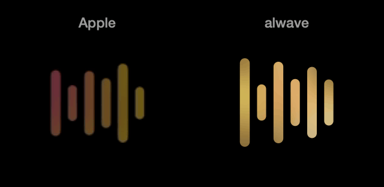

# apple-like-waves (alwave)

> An organic, physically-modeled capsule audio spectrum visualizer across Swift (macOS / iOS) and Web (TypeScript / Canvas).

---

## Visual Comparison & Interactive Demo



- **Live Web Demo**: [https://kmgcc.github.io/apple-like-waves/](https://kmgcc.github.io/apple-like-waves/)

---

## Features

- **Acoustic Octave Binning**: Logarithmic band distribution with density-compensated energy scaling for 6 to 36+ dynamic capsules.
- **Organic Attack & Gating**: Three-tap history reference with soft deadband gating to highlight rhythmic transients without cluttering loud passages.
- **Harmonic Spring Solver**: Second-order analytical damped spring simulation ($\zeta = 0.83$, $\omega_n = 27.54\text{ rad/s}$) providing responsive, jitter-free motion.
- **Dual Ecosystem Architecture**: Pure Accelerate-based Swift implementation and zero-dependency Web TypeScript implementation with identical numerical behavior.

---

## Quick Start

### Swift (Swift Package Manager)

Add `apple-like-waves` to your `Package.swift`:

```swift
dependencies: [
    .package(url: "https://github.com/kmgcc/apple-like-waves.git", from: "1.0.0")
]
```

Add the product to your target:

```swift
.target(
    name: "YourApp",
    dependencies: [
        .product(name: "Alwave", package: "apple-like-waves")
    ]
)
```

Minimal audio processing pipeline:

```swift
import SpectrumCore
import SpectrumUI

// Initialize analyzer
let analyzer = SpectrumAnalyzer(bandCount: 6, sampleRate: 48000)

// In your audio processing loop or tap callback:
analyzer.pushSamples(pcm: pcmFloatBuffer)

// On each display frame update (e.g., CADisplayLink or CVDisplayLink):
let normalizedEnergies = analyzer.step(dt: 1.0 / 60.0) // Returns [Float] in [0, 1]

// Feed energies into the spring dynamics follower:
let follower = CapsuleSpringFollower(count: 6)
let barHeights = follower.step(targets: normalizedEnergies.map(Double.init), dt: 1.0 / 60.0)

// Or render directly in SwiftUI:
AlwaveSpectrumView(values: normalizedEnergies)
```

Adaptive band calculation:
```swift
let recommendedBands = SpectrumAnalyzer.recommendedBandCount(width: view.bounds.width)
```

---

### Web (npm)

Install the packages:

```bash
npm install @alwave/core @alwave/canvas
```

Basic usage with Web Audio API:

```typescript
import { createSpectrumAnalyzer, recommendedBandCount } from "@alwave/core";
import { AlwaveCanvasRenderer } from "@alwave/canvas";

// Create analyzer instance
const analyzer = createSpectrumAnalyzer({
  bandCount: 6,
  sampleRate: 48000,
  tuningProfile: "default"
});

// Attach Web Audio analyser node (PCM float time-domain data)
const buffer = new Float32Array(2048);
analyserNode.getFloatTimeDomainData(buffer);
analyzer.pushSamples(buffer);

// Render loop
const canvas = document.getElementById("visualizer") as HTMLCanvasElement;
const renderer = new AlwaveCanvasRenderer(canvas, { bandCount: 6 });

function render(timestamp: number) {
  const dt = 1 / 60;
  analyserNode.getFloatTimeDomainData(buffer);
  analyzer.pushSamples(buffer);

  const energyTargets = analyzer.step(dt);
  renderer.render(energyTargets, dt);

  requestAnimationFrame(render);
}
requestAnimationFrame(render);
```

---

## Configuration & Tuning Knobs

| Parameter | Type | Default | Description |
|---|---|---|---|
| `bandCount` | `Int` / `number` | `6` | Number of capsule bars (supports 6, 9, 12, 24, 36+). |
| `sampleRate` | `Double` / `number` | `48000` | Input PCM sampling rate. |
| `reactivity` | `Double` / `number` | `1.0` | Global scaling multiplier for transient punch. |
| `noiseGateScale` | `Double` / `number` | `1.0` | Sensitivity threshold for quiet-passage gating. |
| `springDuration` | `Double` / `number` | `0.325` | Characteristic settling time for spring physics. |
| `springDamping` | `Double` / `number` | `0.83` | Damping ratio $\zeta$ ($0.83$ yields $\sim 0.9\%$ overshoot). |

---

## Algorithm Details

For a detailed derivation of the FFT calibration, octave binning, transient attack boost, and spring mechanics, see [docs/ALGORITHM.md](docs/ALGORITHM.md).

---

## Independent Implementation Statement

This repository contains an independent, clean-room implementation of acoustic octave binning and spring-driven capsule spectrum visualization. All mathematical models, parameter tunings, and physics formulations are independently derived, calibrated from acoustic behavioral observations, and implemented without third-party proprietary source code.

---

## License

This project is licensed under the MIT License. See the [LICENSE](LICENSE) file for details.
