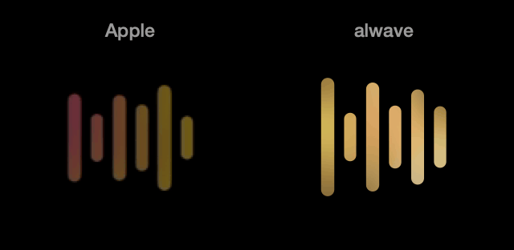

# apple-like-waves

[English](README.md) · [中文](README.zh-CN.md)

参考 Apple 系统动画效果制作的音频频谱可视化组件，支持 Swift 与 Web。



[在线演示](https://kmgcc.github.io/apple-like-waves/)

apple-like-waves (alwave) 将实时音频转换为带弹簧物理动效的胶囊柱，适用于音乐播放器、录音工具与交互式音频界面。

## 特性

- 参考 Apple 系统音频频谱制作的胶囊柱动效
- 支持 6 至 36 根频段胶囊，并提供基于宽度的 `recommendedBandCount` 自动分段计算
- 响应节奏强弱与音量变化
- 暂停时提供平滑的弹簧回弹与收缩过渡
- 支持自定义配色、胶囊宽度、间距与灵敏度
- 支持 SwiftUI (`CapsuleSpectrumView`)、AppKit (`CapsuleSpectrumHostView`，基于 `CALayer`) 与 HTML Canvas (`AlwaveCanvasRenderer`)

## 在线演示

在线 Web 演示包含内置示例音频、本地音频拖拽上传、麦克风实时输入以及调节控件：

[打开在线演示](https://kmgcc.github.io/apple-like-waves/)

## 快速上手

### Swift

支持 iOS 16+ 与 macOS 14+。在 `Package.swift` 中添加依赖：

```swift
dependencies: [
    .package(url: "https://github.com/kmgcc/apple-like-waves.git", from: "1.0.0")
]
```

并在 Target 中引入 `Alwave`：

```swift
.target(
    name: "YourApp",
    dependencies: [
        .product(name: "Alwave", package: "apple-like-waves")
    ]
)
```

音频分析与步进调用：

```swift
import SpectrumCore
import SpectrumUI

// 初始化分析器
let analyzer = SpectrumAnalyzer(bandCount: 6, sampleRate: 48000)

// 在音频输入回调中推入 PCM 采样：
analyzer.pushSamples(pcm: pcmBuffer)

// 屏幕刷新回调（如 CADisplayLink）中推进时间步，获取 [0, 1] 归一化高度：
let targets = analyzer.step(dt: 1.0 / 60.0)
```

使用 SwiftUI 渲染：

```swift
CapsuleSpectrumView(values: targets)
```

使用 AppKit (`NSView`) 渲染：

```swift
let hostView = CapsuleSpectrumHostView(capsuleCount: 6)
hostView.update(values: targets)
hostView.isPaused = false
```

根据视图宽度计算建议频段数：

```swift
let bandCount = SpectrumAnalyzer.recommendedBandCount(width: view.bounds.width)
```

### Web

Web 依赖包（`@alwave/core` 与 `@alwave/canvas`）位于本仓库的 `web/` 工作区。如需在项目中使用，可克隆并在本地构建：

```bash
git clone https://github.com/kmgcc/apple-like-waves.git
cd apple-like-waves/web
pnpm install
pnpm build
```

在前端项目中引入对应包：

```typescript
import { createSpectrumAnalyzer, recommendedBandCount } from "@alwave/core";
import { AlwaveCanvasRenderer } from "@alwave/canvas";

// 初始化分析器
const analyzer = createSpectrumAnalyzer({
  bandCount: 6,
  sampleRate: 48000
});

// 绑定 Canvas 渲染器
const canvas = document.getElementById("visualizer") as HTMLCanvasElement;
const renderer = new AlwaveCanvasRenderer(canvas, { bandCount: 6 });

const pcmBuffer = new Float32Array(2048);

function render() {
  const dt = 1 / 60;
  analyserNode.getFloatTimeDomainData(pcmBuffer);
  analyzer.pushSamples(pcmBuffer);

  const targets = analyzer.step(dt);
  renderer.render(targets, dt);

  requestAnimationFrame(render);
}
requestAnimationFrame(render);
```

## 调节参数

| 参数 | 类型 | 默认值 | 说明 |
|---|---|---|---|
| `bandCount` | `Int` / `number` | `6` | 频段数量（支持 6–36） |
| `sampleRate` | `Double` / `number` | `48000` | 输入 PCM 采样率（Hz） |
| `reactivity` | `Double` / `number` | `1.0` | 瞬态起音加成倍率 |
| `noiseGateScale` | `Double` / `number` | `1.0` | 噪声门限敏感度系数 |
| `capsuleWidth` | `CGFloat` / `number` | `4.0` | 胶囊基础宽度（点或像素） |
| `capsuleSpacing` | `CGFloat` / `number` | `3.0` | 相邻胶囊间距 |
| `barColor` / `color` | `Color` / `string` | `.white` / `"#E6C450"` | 胶囊填充颜色 |
| `springDuration` | `Double` / `number` | `0.325` | 弹簧特征收敛时长（秒） |
| `springDamping` | `Double` / `number` | `0.83` | 阻尼比 $\zeta$（约 0.9% 过冲） |

## 运行原理

分析器对输入的 PCM 样本执行 2048 点 Hann 窗加窗实数快速傅里叶变换，并将频谱映射至对数八度频段。各频段能量经过标定，并结合最近 3 步分析帧的历史加权均值与慢跟随音量门限进行瞬态起音加成。显示层采用受阻尼二阶谐振子物理模型驱动胶囊高度与宽度，在帧率变动时保持平滑过渡。

Swift 与 Web 实现共享相同的计算逻辑与默认参数（[spec/default-tuning.json](spec/default-tuning.json)）。数学推导与参数细节详见 [docs/ALGORITHM.md](docs/ALGORITHM.md)。

## 许可证

本项目基于 [MIT 许可证](LICENSE) 发布。
